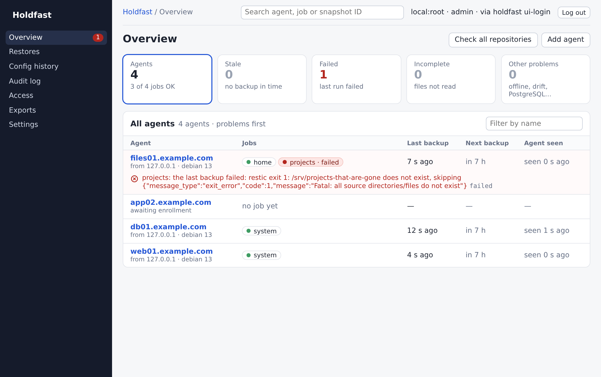

# Holdfast

[](https://github.com/kabsdk/holdfast/actions/workflows/ci.yml)
[](https://github.com/kabsdk/holdfast/releases/latest)
[](LICENSE)
[](https://kabsdk.github.io/holdfast/)

**Restic backups for a fleet of Linux servers, run from one place.** You install one Holdfast server, put a small
agent on every host, and say what to back up and how long to keep it. The agents make encrypted backups with
[restic](https://restic.net) and send them through the server to your own S3 storage. The server keeps the settings
and the history, checks that every backup really is in the bucket, cleans up every day under a 7-day safety rule, and
tells you by mail or chat when something is wrong.

**[Read the documentation →](https://kabsdk.github.io/holdfast/)**

The current release, **0.1-dev**, is a development release and subject to change: until 0.1.0, newer builds replace
it under the same name.



## What you get

- **Central jobs**: paths, excludes, a schedule and a retention per job, set in the web UI, the CLI or the API.
  A new job needs only its paths; the schedule and the retention have sound defaults.
- **No storage key on any host**: agents back up through the server's gateway, which lets each host read and add to
  its own repository only.
- **Retention as time windows**, decided by restic's own `forget --dry-run`, and **safe deletion**: every deletion
  waits 7 days and can be cancelled, with S3 versioning behind it.
- **Browsing and restoring**: file names and metadata of every snapshot, what changed between two, and restores on
  the host, into a new folder, in place, onto another host or from the off-site copy. File contents never leave a
  host through Holdfast.
- **Backups checked in the bucket**: after every backup the server reads the repository back from S3.
- **No commands run on your hosts**: the agent runs restic, and nothing before or after it. A database is backed up
  from the export a systemd timer on the host writes.
- **Optional off-site copies**, **checks with stable codes** that stop mistakes before they are saved, and a **config
  history and audit log** of every change and action.
- **Alerts without extra software** (mail, webhook, heartbeat), Prometheus metrics if you want them, and a
  **web UI** with OIDC login and three roles.
- **Recovery of Holdfast itself**: a nightly encrypted export, every repository password escrowed with `age`, and
  one recovery file that rebuilds a lost server on the same bucket.

The web UI, the HTTP API and the `holdfast` CLI offer the same actions with the same checks.

## Who it is for

A small operations team looking after roughly ten to a few hundred Linux servers, with S3-compatible storage of its
own (Ceph RGW, MinIO, AWS S3 or another). Holdfast runs as **one server with no high availability**: while it is
down, backups wait, and a lost server is replaced by a new one on the same bucket. It is not for Windows, macOS or
Kubernetes volumes.

## Quick start

Make a bucket with versioning and two keys at your S3 server
([how](https://kabsdk.github.io/holdfast/#storage)), put the settings in `/root/holdfast.env`, and run, as root on
the server:

```sh
set -a; . /root/holdfast.env; set +a
curl -sfL https://github.com/kabsdk/holdfast/releases/latest/download/install.sh | sh -s - server
```

Then add a host. `host add` prints the one line to run on that host, which installs and enrolls its agent:

```sh
holdfast host add web01.example.com
holdfast job set web01.example.com system --path /etc --path /home
```

Or install everything with Ansible, with the same settings:

```sh
ansible-galaxy collection install https://github.com/kabsdk/holdfast/releases/download/v0.1-dev/kabsdk-holdfast-0.1-dev.tar.gz
ansible-playbook -i inventory.yml kabsdk.holdfast.site
```

The [quick start](https://kabsdk.github.io/holdfast/#quickstart) walks through every step, and the
[collection's guide](ansible/README.md) covers the inventory.

## Requirements

- Linux on x86_64 with systemd and apt or dnf; tested on Ubuntu 24.04, AlmaLinux 9 and Oracle Linux 9.
- S3-compatible storage with bucket versioning, lifecycle rules and per-key policies.
- PostgreSQL 16 or 17 for the server; the installer sets it up.
- restic is shipped with Holdfast, at the version each release is tested with.

## Documentation

| | |
| --- | --- |
| [kabsdk.github.io/holdfast](https://kabsdk.github.io/holdfast/) | The guide: architecture, installation, use, operation, security, reference |
| [docs/spec.md](docs/spec.md) | The full behaviour specification |
| [docs/decisions/](docs/decisions/) | Each design decision and its reasons |
| [docs/runbooks/](docs/runbooks/) | Rebuilding the server, a compromised host, bare-metal recovery |
| [ansible/README.md](ansible/README.md) | The Ansible collection `kabsdk.holdfast` |
| [CHANGELOG.md](CHANGELOG.md) | What each release changed |

## Contributing and security

Bug reports and pull requests are welcome: [CONTRIBUTING.md](CONTRIBUTING.md) says how to build and test, and the
rules every change keeps. Please report security problems privately, as [SECURITY.md](SECURITY.md) describes.

## Licence

Apache License 2.0: see [LICENSE](LICENSE) and [NOTICE](NOTICE). Each package also carries the licences of the
third-party software it contains, in `/usr/share/doc/<package>/`.
